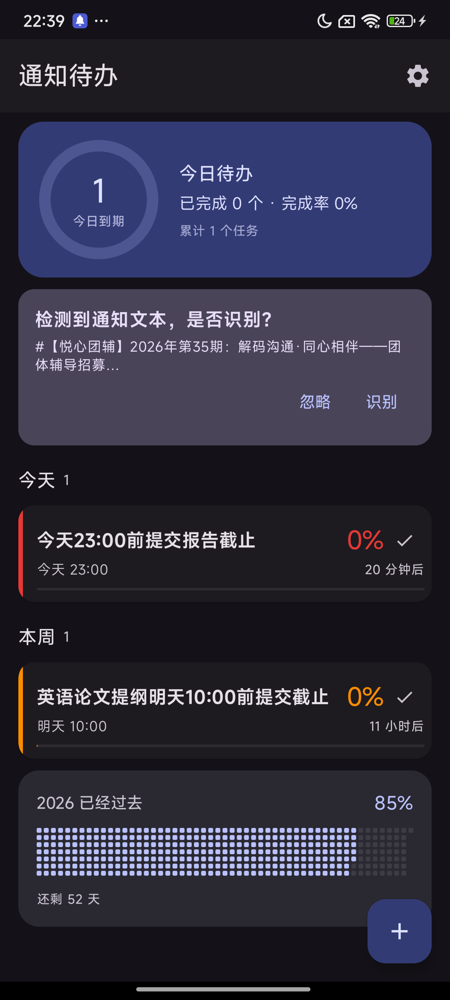
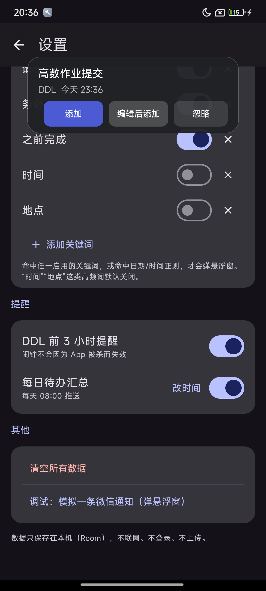
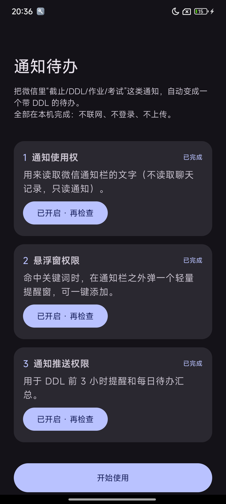

# 通知待办 NoticeTodo

把微信通知里「截止 / DDL / 作业 / 考试」这类信息，自动变成一个带截止时间的本地待办。
命中关键词时弹一个轻量悬浮窗，一键 **添加 / 编辑后添加 / 忽略**。

原生 Android（Kotlin + Jetpack Compose，**不是 Flutter**），全部在本机完成：
Room 存数据、DataStore 存设置，不联网、不登录、不上传。

[](LICENSE)
-3DDC84)


## 截图

| 主页 | 悬浮窗 | 首次引导 |
| --- | --- | --- |
|  |  |  |

## 它能做什么

- **监听微信通知**：`NotificationListenerService` 只处理 `com.tencent.mm`，只读通知栏文字，不读聊天记录。
- **本地规则解析**：关键词 + 日期/时间正则，抽出名称、DDL、课程/项目、优先级；解析不出来就留空，不猜。
- **悬浮窗**：命中后在通知栏之外弹出，可拖动，15 秒无操作自动收起，三个按钮。
- **主页分组**：逾期 / 今天 / 本周 / 以后，逾期标红置顶；卡片带优先级色点和进度条。
- **进度条**：从创建时间到 DDL 线性推进，越接近越满，逾期满格标红并显示「已逾期 X 天」。
- **提醒**：DDL 前 3 小时精确闹钟（`AlarmManager`，重启后自动重排）；每天 08:00 待办汇总（WorkManager）。
- **兜底导入**：剪贴板检测、系统分享菜单（`text/plain`）、FAB 手动新建。
- **权限引导**：通知使用权 / 悬浮窗 / 通知推送，被拒不阻塞，设置页可随时重开。
- **本地存储**：Room（version 1，预留 Migration），杀进程重启不丢。

## 快速开始

```bash
git clone https://github.com/Dengdog/NoticeTodo.git
cd NoticeTodo
gradlew.bat assembleDebug          # Windows
# ./gradlew assembleDebug          # macOS / Linux
```

产物：`app/build/outputs/apk/debug/app-debug.apk`

```bash
adb install -r app/build/outputs/apk/debug/app-debug.apk
```

### 环境要求

| 依赖 | 版本 |
| --- | --- |
| JDK | 17 |
| Android SDK | `platforms;android-36`、`build-tools;36.0.0` |
| 环境变量 | `JAVA_HOME`、`ANDROID_HOME` |

工程里**不生成 `local.properties`**，SDK 路径完全由 `ANDROID_HOME` 提供，不需要 Android Studio。

首次构建会从华为云下载 Gradle 8.11.1 分发包（约 130MB），依赖走阿里云镜像；
之后走本地 Gradle 缓存，增量构建约 30 秒。仓库地址写死在 `settings.gradle.kts`，
国内网络可直接构建。

### 首次使用

1. 打开 App，按引导授予「通知使用权」「悬浮窗权限」「通知推送权限」。
   小米 / 华为还需要在系统里额外允许「自启动」「后台弹出界面」「省电策略无限制」。
2. 用另一台手机（或电脑微信 → 文件传输助手）发一条：

   ```
   【高数】@所有人 明天 18:00 前提交作业，收到请回复
   ```

3. 预期：弹出悬浮窗「高数作业提交 / DDL 明天 18:00」，点「添加」进主页「本周」分组。

模拟器上没有微信，可以在「设置 → 其他 → 调试：模拟一条微信通知（弹悬浮窗）」
走一遍完整链路（仅 debug 包含该入口）。

## 收不到悬浮窗？按这个顺序查

典型症状：微信消息来了不弹窗，**打开 App 之后才弹**。这是后台进程被 ROM 冻结、回调被
推迟到进程唤醒才执行，不是解析逻辑的问题。App 内置了三层防护，仍不行就按顺序检查：

1. **常驻通知保活**（设置 → 后台运行）保持开启。开启后状态栏有一条低优先级的
   「通知待办正在监听微信通知」通知，这是前台服务，把进程优先级抬到 `fg-service`，
   避免被系统/ROM 冻结。
2. **电池优化白名单**（设置 → 后台运行 → 电池优化白名单）→「去开启」。
3. **自启动 / 后台弹出界面**（设置 → 后台运行 → 自启动）在系统里允许：
   小米是「自启动」+「后台弹出界面」+「省电策略：无限制」，华为是「应用启动管理 → 手动管理」，
   OPPO / vivo 类似。
4. 还不行就看 **设置 → 后台运行 → 运行日志**，每一步都有记录：
   - `[notify] 收到微信通知 ...` → 通知收到了
   - `[notify] 未命中关键词` → 被关键词过滤了，去关键词页加词
   - `[overlay] 悬浮窗已显示` / `没有悬浮窗权限` / `addView 失败：...`
   - `[keepalive] foreground started` / `startForeground failed: ...`
   - `[listener] connected` / `disconnected` → 监听连接状态

日志同时写在 `filesDir/diag.log`，debug 包可以用
`adb shell run-as com.dengao.noticetodo cat files/diag.log` 直接取。

## 架构

```
app/src/main/java/com/dengao/noticetodo/
├─ MainActivity.kt            入口：分享导入、剪贴板、通知点击
├─ AppContainer.kt            手写依赖容器
├─ data/                      Room、DataStore、Repository
│  ├─ local/                  TaskEntity / TaskDao / AppDatabase / NotificationLog
│  ├─ SettingsRepository.kt   关键词、提醒开关、汇总时间
│  └─ TaskRepository.kt       任务读写 + 提醒排期
├─ domain/model/              Task、Priority、TaskSource、分组与进度计算
├─ parser/                    关键词命中 + DDL 正则 + Parser 接口
├─ notification/              监听、悬浮窗、提醒、汇总
├─ ui/                        Compose 页面（引导 / 主页 / 编辑 / 设置）与主题
└─ util/TimeUtils.kt          时间格式化与逾期天数
```

关键设计：

- **通知去重**用 `(notificationKey, postTime)` 而不是只用 key——微信同一会话会复用 key，
  只用 key 去重会把该会话后续消息全部吞掉。
- **解析器是接口**（`NoticeParser`），本地规则实现为 `LocalRuleParser`，
  之后想换成云端解析直接实现接口即可，调用方不用改。
- **提醒用精确闹钟而不是 WorkManager**：WorkManager 不保证准时；
  没有精确闹钟权限时自动退回 `setAndAllowWhileIdle`，不崩溃。

## 技术栈

AGP 8.9.1 · Gradle 8.11.1 · Kotlin 2.1.0 · Compose BOM 2024.12.01 ·
compileSdk 36 / minSdk 26 / targetSdk 34 · KSP 2.1.0-1.0.29 ·
Room 2.7.0 · WorkManager 2.10.0 · Lifecycle 2.8.7 · Navigation Compose 2.8.5 ·
DataStore 1.1.1 · Coroutines 1.9.0

## 已知边界

- 只解析通知栏文字。微信群消息被折叠成「3 条新消息」时拿不到正文，此时仍会弹窗/发兜底通知，
  需要点「编辑后添加」手动补全 DDL——这是纯本地规则解析的天花板。
- 只在通知到达时触发；App 被 ROM 杀掉后能否收到取决于「自启动 / 后台弹出界面」权限。
- 不做通知内容级永久去重（只做技术去重）。
- 不做邮箱、云同步、账号登录、子任务、日历视图、统计图表。
- `SCHEDULE_EXACT_ALARM` 在 Android 14+ 对新装应用默认不授予；没有时提醒仍会发，只是可能不准。

## License

[MIT](LICENSE) © 2026 Dengao
